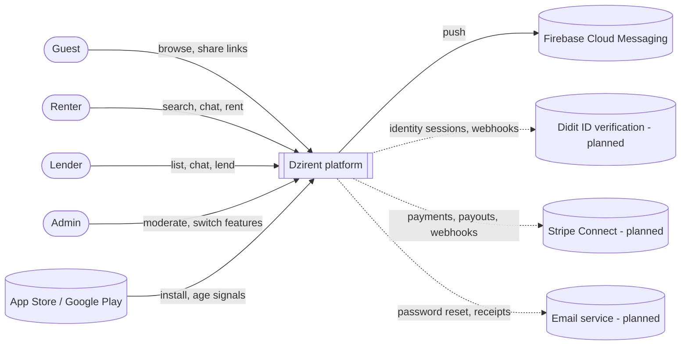
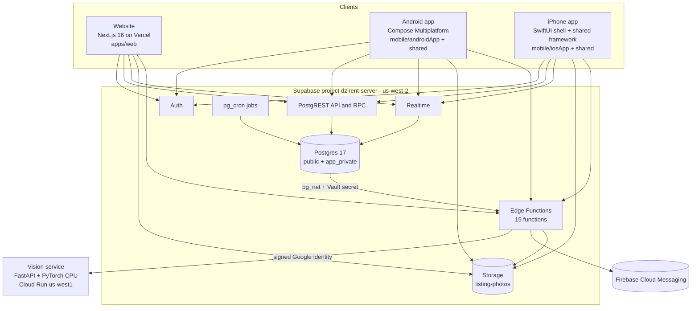
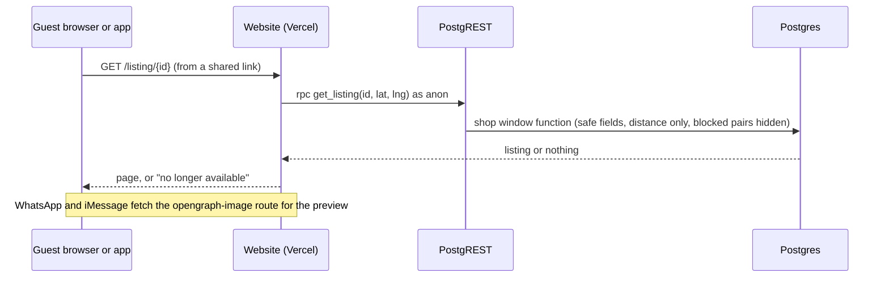
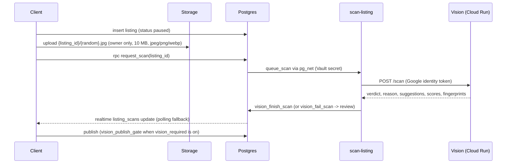
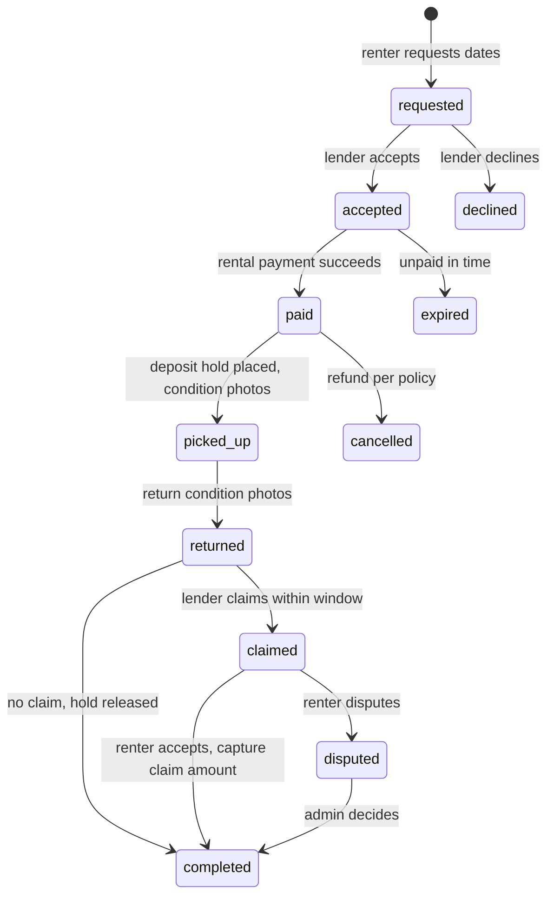
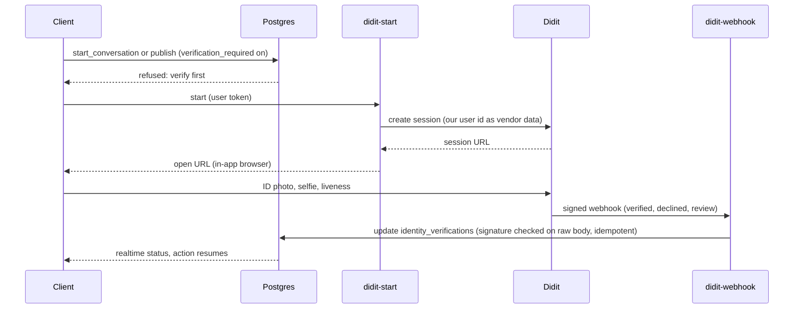

# Dzirent - Architecture and Design Blueprint

| | |
|---|---|
| Template | arc42 (12 sections), C4 model diagrams (levels 1-3), Architecture Decision Records (ADR) |
| Level 4 (code) | Generated: `code-reference.md` (every source file, its size and every top-level declaration) |
| Source of truth | `Preview` branch of `Vivek-k24/Dzirent`, the live `dzirent-server` database catalog, and `pranalika/` |
| Snapshot date | 2026-11-11 |
| Excludes | Secret values and provider API keys (only their names appear) |

**Status legend** used on every row: ✅ built and running · ⚠️ built with known limits · 🟡 designed, not built · ❌ missing (no design yet)

**How to read this.** Sections 1-4 explain *why* the system looks the way it does. Sections 5-7 describe *what* exists and *where* it runs. Section 8 walks every cross-cutting concern (the full engineering checklist). Section 11 is the gap register: everything this document exposed as missing, ranked. Appendices A and B are the designs for payments, deposits and ID verification. Appendix C is generated inventory.

---

## 1. Introduction and goals

### 1.1 What Dzirent is
A peer-to-peer clothing rental marketplace. Lenders list pieces they own; renters nearby browse, message, and arrange pickup and return in person. Launch market: Austin, TX. Platforms: website (dzirent.com), Android, iPhone, all sharing one backend.

### 1.2 Core requirements (V1.0 scope plus what has been added since)
| # | Requirement | Status |
|---|---|---|
| R1 | Guests browse everything public (home, search, filters, listing pages) without an account | ✅ |
| R2 | Sign-up, sign-in, onboarding by role (renter, lender, both) | ✅ |
| R3 | Listing creation with photos, measurements, availability, accessory declaration | ✅ |
| R4 | Automatic photo checks: allowed / rejected with reason / human review, with suggestions to fill the form | ✅ |
| R5 | In-app chat with live updates and push notifications (Android) | ✅ (iPhone push 🟡) |
| R6 | Fit matching from private body measurements | ✅ |
| R7 | Studios (lender pages), saving pieces and studios | ✅ |
| R8 | Report and block; admin moderation with audit log | ✅ |
| R9 | Legal: terms acceptance with versions, measurements consent, data download, account deletion, 18+ | ✅ |
| R10 | Sharing with rich link previews and Android app links | ✅ (iPhone links 🟡) |
| R11 | ID verification once per account (Didit) | 🟡 Appendix B |
| R12 | Payments, platform fee and refundable deposits (Stripe Connect) | ⚠️ backend built and tested against stripe-mock (C4), switched off; screens in C5 (Appendix A) |
| R13 | Rental reminders and email notifications | 🟡 needs the rental confirmation step (Appendix A) and an email service |

### 1.3 Top quality goals
| Priority | Goal | Meaning for Dzirent |
|---|---|---|
| 1 | Safety and trust | Strangers meet in person; abuse, scams and banned items must be catchable and actionable |
| 2 | Privacy | Collect little, lock everything to its owner, no tracking, no selling, honest disclosures |
| 3 | Cross-platform consistency | The same rules on website, Android and iPhone, enforced once in the database |
| 4 | Operability by a non-developer | Owner runs no commands; switches, queues and cleanups live in an admin website |
| 5 | Cost control | Free tiers where possible; a hard $20 cap on the paid compute project |

### 1.4 Stakeholders
| Role | Expectation |
|---|---|
| Owner (product, coordinator) | A working platform and a clean handoff |
| Business owner (BO) | Legal, payments and packaging decisions; testing; eventually operating Dzirent |
| Renters, lenders | Safe, simple, private |
| Admins | Clear queues, reversible actions, evidence |
| App stores, regulators | Policy compliance (UGC, privacy, age) |
| Agents (Claude Code, Antigravity) | Clear rules (`pranalika/README.md`), contracts, handoffs |

---

## 2. Architecture constraints

| Kind | Constraint |
|---|---|
| Technical | Supabase (Postgres 17, Auth, Storage, Realtime, Edge Functions on Deno) is the only backend. No separate API server. |
| Technical | Website: Next.js 16 (App Router, React 19) on Vercel. Apps: Kotlin Multiplatform with Compose Multiplatform 1.7.3 (Kotlin 2.1.0), one shared module for Android and iPhone. |
| Technical | AI runs only on own code or open-source models (no paid AI or LLM services). Photo model: Marqo-FashionSigLIP and Marqo NSFW detector on Google Cloud Run (CPU). |
| Technical | Every database change is a migration file applied with the Supabase CLI. No dashboard edits. |
| Organizational | Two long-lived branches: `main` (production) and `Preview` (preview site). `ios01` is used for Mac sessions and merged into `Preview`. |
| Organizational | The owner never runs local commands. Agents do all git and build work and write handoffs that state only what they ran. |
| Organizational | Secrets never enter the repo (it is public). Local values in `H:\DziRent\secrets\`, CI values in GitHub secrets, website values in Vercel, server values in Supabase function secrets and Vault. |
| Cost | Google Cloud project `dzirent` has a $20 monthly budget wired to a function that unlinks billing. |
| Legal | App Store and Google Play UGC rules, Texas SB 2420 and Utah app store age laws, COPPA and Texas SCOPE Act (no minors), state privacy laws (Texas TDPSA and others), biometric laws (for ID checks), DMCA, ADA (WCAG 2.1 AA). |

---

## 3. Context and scope

### 3.1 Business context (C4 level 1)

### 3.2 External interfaces
| Partner | Direction | Data | Status |
|---|---|---|---|
| Google Play Age Signals | Store to app | Age range for users in covered states | ✅ Android |
| Apple Declared Age Range | Store to app | Same, iOS 26.2+ | ⚠️ code in place, needs paid Apple account |
| Firebase Cloud Messaging | Platform to Google to phone | Device token, notification title, chat id, optional message text | ✅ Android, 🟡 iPhone |
| Didit | Platform to Didit, webhook back | Session per user, verification result | 🟡 |
| Stripe Connect | Platform to Stripe, webhooks back | Payments, holds, payouts, lender onboarding | 🟡 |
| Email service (Resend, Postmark or SES) | Supabase Auth and functions to provider | Password reset, confirmation, receipts | ❌ not chosen |
| WhatsApp, iMessage, RCS and other apps | Shared links | Public listing and studio previews | ✅ |

---

## 4. Solution strategy

| Problem | Approach |
|---|---|
| Three clients must behave the same | Business rules live in the database: row-level security, constraints, triggers and "shop window" functions. Clients are thin. |
| Privacy | Owner-only tables; public data only through functions that return safe fields; coordinates rounded to about 1 km and shown only as distance; no tracking SDKs. |
| Two apps, one team | Kotlin Multiplatform shared module (`mobile/shared`): one UI and data layer for Android and iPhone; platform features behind `expect`/`actual` interfaces. |
| Trust without heavy moderation staff | Automatic checks first (photo scanner, text filter on public text), human review only for the unsure, reports with frozen evidence. |
| Asynchronous work without a message broker | Database triggers queue HTTP calls with `pg_net` to Edge Functions; shared secrets in Supabase Vault; nightly jobs with `pg_cron`. |
| Expensive AI | A single CPU container on Cloud Run, scale to zero, max one instance, behind Google IAM, under a $20 kill switch. |
| Run by a non-developer | Feature flags, queues, cleanup switches and audit log in the admin website, with two-step sign-in. |

---

## 5. Building block view

### 5.1 Containers (C4 level 2)

### 5.2 Website (`apps/web`) - C4 level 3

| Part | Contents |
|---|---|
| Routing | App Router pages: home `/`, `/search`, `/listing/[id]`, `/studio/[handle]`, `/studios`, `/saved`, `/fit`, `/auth`, `/auth/callback`, `/app/[feature]`, `/app/list-a-piece/[id]`, `/app/messages/[id]`, `/app/settings/[section]`, legal and help pages (`/privacy`, `/terms`, `/community-guidelines`, `/copyright`, `/safety`, `/delete-account`, `/support`, `/help`, `/about`, `/accessibility`), admin (`/admin`, `/admin/reports`, `/admin/photo-reviews`, `/admin/listings`, `/admin/users`, `/admin/takedowns`, `/admin/flags`, `/admin/id-verification`, `/admin/audit-log`) |
| Preview images | `opengraph-image` routes for listings and studios (1200x630 PNG) |
| API routes | `/api/cities`, `/api/preferences`, `/api/workflows/[...path]` (server-side gateway for signed-in workflows) |
| Request proxy | `src/proxy.ts`: refreshes the Supabase session cookie on every request; returns 404 for `/admin` unless signed in as an admin with a fresh two-step code |
| Server logic | `lib/workflow-server.ts`, `workflow-mutations.ts`, `listing-mutations.ts`, `admin-actions.ts`, `data.ts` (shop window reads), `og.tsx`, `share.ts`, `refusals.ts`, `suspension.ts`, `drafts.ts`, `preview.ts` |
| Components | Shell (header, docked filter panel, drawer), cards, listing editor and fields, chat, inbox, closet, settings, measurements editor, studio editor, onboarding, guest gate, terms update, age-blocked page, share button, admin views |
| Content | `content/legal/config.ts`: every legal fill-in, `legalDraft`, `TERMS_VERSION`, `PRIVACY_VERSION` |
| Styling | One global stylesheet with theme tokens (light default, dark), `data-theme` attribute |

### 5.3 Mobile shared module (`mobile/shared`) - C4 level 3

| Layer | Package | Responsibility |
|---|---|---|
| Model | `model/Models.kt` | Serializable data classes for every table and function result |
| Repository | `repository/DzirentRepository.kt` | The only gateway to Supabase (Auth, PostgREST, RPC, Storage, Realtime, Functions); maps refusals to user messages |
| Data | `data/ListingPublisher.kt`, `data/PhotoAnalysis.kt` | Listing publish pipeline (upload, scan, publish), on-device photo quality |
| Platform contracts | `platform/*` and `expect` declarations | `PlatformServices` (location, photo picker, camera, compression, settings), `SecureSession`, `Push`, `AgeSignals`, `DataExport`, `Device`; `expect` functions for back handling, system bar icons, permission requests, licenses, accent stripping |
| UI | `ui/*` | Every screen (home, search, listing, studio, editor in steps, chat, inbox, closet, saved, settings, measurements, moderation, legal, age-blocked, guide, welcome) built with Compose Multiplatform |
| Utilities | `util/*` | Pure rules: fit, geo, dates, price, sizes, sort, search-related words, photo gate and thresholds, onboarding, suspension, share links, US states |
| Android side | `androidMain` | Keystore-backed session store, Firebase messaging service, notifications, Play Age Signals, save-file export, permissions, app links |
| iPhone side | `iosMain` + `mobile/iosApp` | Keychain session store, Declared Age Range bridge (Swift), photo and camera, export (opens website), privacy manifest |

### 5.4 Database (`supabase/`) - C4 level 3

**Schemas.** `public` (application data and API functions), `app_private` (closed: admin, evidence, settings, filters, counters, job runs; not exposed by the API), `storage` (buckets `listing-photos`, public, and since C3 `rental-photos`, private condition photos).

**Table groups** (full columns in Appendix C.1):

| Group | Tables |
|---|---|
| People | `profiles`, `private_profiles`, `age_checks`, `legal_acceptances`, `notification_settings`, `device_tokens`, `data_exports`, `user_warnings` |
| Catalog | `listings`, `listing_photos`, `listing_measurements`, `availability`, `listing_events`, `listing_declarations`, `accessory_declarations`, `us_cities`, `policy_item_types` |
| Photo checks | `listing_scans`, `photo_scans` (768-dimension fingerprint, `pgvector`) |
| Social | `conversations`, `messages`, `conversation_reads`, `rentals`, `rental_events` (C3), `rental_outcomes`, `saved_listings`, `saved_studios`, `blocks`, `reports`, `suggestion_events` |
| Configuration | `app_settings` (feature flags), `legal_documents` |
| Closed (`app_private`) | `admin_users`, `admin_actions` (append-only), `report_evidence`, `takedown_requests`, `settings`, `text_filter_terms`, `text_filter_allowed`, `rate_counters`, `job_runs` |

**Catalog size** (live): 45 row-level security policies, 138 functions (105 run with elevated rights, each with a fixed search path), 42 triggers, 91 indexes, 2 cron jobs, 1 bucket (public, 10 MB limit, JPEG/PNG/WebP), realtime on `messages`, `rentals`, `listing_scans`. Extensions: `pg_trgm`, `unaccent`, `vector`, `pg_net`, `pg_cron`, `pgcrypto`, `uuid-ossp`, `supabase_vault`, `pg_stat_statements`.

**API surface.** Guests can call exactly four functions: `browse_listings`, `get_listing`, `search_cities`, `check_text`. Every other function requires sign-in; admin functions also require admin membership and a two-step session no older than 24 hours. Full list in Appendix C.2.

### 5.5 Edge Functions (`supabase/functions`)

| Function | Called by | Purpose | Auth |
|---|---|---|---|
| `scan-listing` | Database (`queue_scan` via `pg_net`) | Sends photo URLs to the vision service, writes `listing_scans` and `photo_scans` | Vault shared secret; signs in to Cloud Run as `vision-invoker` |
| `send-push` | Database triggers (new message, new chat, dates changed) and, since C3, the rental functions and the daily reminder job | Builds and sends Firebase notifications; removes dead tokens | Vault shared secret; Firebase service account |
| `cleanup-files` | `pg_cron` | Deletes orphan and abandoned-draft photo files through the Storage API | Vault shared secret |
| `delete-listing` | Apps and website | Deletes a listing's photos, then the listing | User token verified in code |
| `delete-account` | Apps and website | Deletes the caller's photos, then the account | User token verified in code |
| `export-my-data` | Apps and website | One JSON file of everything held about the caller, once a day | User token verified in code |
| `admin-actions` | Admin website | Ban, unban, photo file removal | Admin with fresh two-step session |
| `stripe-onboard`, `stripe-account-status` (C4) | Apps and website (C5) | A lender's Stripe Express account and onboarding link; its status | User token verified in code |
| `stripe-pay` (C4) | Apps and website (C5) | The renter's destination-charge PaymentIntent (client secret) | User token verified in code |
| `stripe-deposit` (C4) | The lender at pickup; the outbox | Place, release, capture and renew deposit holds | User token, or Vault shared secret `payments_job_secret` |
| `stripe-refund` (C4) | The outbox | Refunds and cancelling unpaid payments | Vault shared secret |
| `stripe-webhook` (C4) | Stripe | Payment, refund, dispute and account events, once each | Stripe signature on the raw body |
| `admin-integrations` (C4) | Admin website | Which outside services have their secrets set (yes/no only) | Admin with fresh two-step session |
| `send-email` (C5) | The outbox (`send_email`) | Renders a transactional email and sends it with one HTTPS call to the provider; skipped while `EMAIL_API_KEY` is blank | Vault shared secret `email_job_secret` |
| `_shared` | (library) | Input validation and common helpers; C5: the email templates and the provider adapter | - |

### 5.6 Vision service (`services/vision`)

| Module | Responsibility |
|---|---|
| `main.py` | FastAPI app: `GET /health`, `POST /scan` |
| `fetch.py` | Downloads photos only from allowed URL prefixes (`VISION_ALLOWED_URL_PREFIXES`) |
| `model.py`, `build_assets.py` | Loads Marqo-FashionSigLIP (baked into the image at build time) |
| `safety.py` | Marqo NSFW detector (nudity: reject; uncertain: review) |
| `verdict.py`, `policy.json`, `vocab.*` | Allowed / not allowed / review from the policy table (kept in sync with `policy_item_types` by a test) |
| `quality.py`, `colors.py`, `text.py` | Blur, brightness, framing, worn probability; colors from pixels; title and description templates |
| `tests/`, `eval/run_eval.py` | Unit tests; evaluation against sample and owner photos |

Runs as `vision-runtime` (no project roles), invoked only by `vision-invoker`, min 0 / max 1 instance, CPU only, image pinned by digest (`python:3.12.10-slim-bookworm`), every Python package pinned.

---

## 6. Runtime view

### 6.1 Guest browses and opens a shared link

### 6.2 Sign-up, terms and age
1. Client sends display name through `check_text(name,'profile')`, then Supabase Auth sign-up (email and password, 8+ characters, leaked-password check).
2. `handle_new_user` trigger creates `profiles` and `private_profiles` rows.
3. Client calls `accept_legal(platform)` (current versions from `legal_documents`) and `record_age_check` (website: self-declared; Android: Play Age Signals; iPhone: Declared Age Range).
4. Any write needing current terms is refused by `require_current_terms` until accepted; a `minor` result blocks every write (`refuse_minor_account`).

### 6.3 Listing with photo checks

Photos changed on an active listing are re-scanned automatically (`rescan_on_photo_change`); a non-allowed result pauses the listing with `auto_paused_reason` when the flag is on.

### 6.4 Chat and push
1. `start_conversation` (validates listing, blocks, suspension, terms, rate limit).
2. Insert into `messages` (rate limit 30/minute; no text filter in chat by owner decision).
3. Trigger `push_new_message` -> `queue_push` -> `send-push` -> Firebase -> phone; no push when blocked, when the recipient turned messages off, or when the chat is open on screen. Lock screen shows no text unless the recipient opted in.
4. Realtime delivers the message to open clients; `mark_conversation_read` updates `conversation_reads`.

### 6.5 Report to admin action
1. `report_user` / report insert -> `report_capture` trigger freezes evidence into `app_private.report_evidence` (message plus five before and after, or listing or profile as it was).
2. Admin (two-step, fresh within 24 hours) opens `/admin/reports`, chooses an outcome; `close_report`, `set_suspension`, `admin_remove_reported_content` or `admin-actions` (ban) run; every action writes `admin_actions` (append-only).

### 6.6 Account deletion and data download
- `delete-account`: verifies the user, deletes storage folders, deletes the auth user; cascades remove owned rows; chats and rentals are deleted for both people; reports, evidence and declarations remain for their retention periods.
- `export-my-data`: verifies the user, assembles one JSON document (other people only by name and handle), records `data_exports`, refuses a second export within 24 hours.

### 6.7 Nightly cleanup
`pg_cron` 09:15 UTC runs `run_cleanup_jobs` (database cleanups); 09:30 UTC calls `cleanup-files` (file deletions). Each job is count-only until an admin switches it to delete; each run is recorded in `job_runs`.

### 6.8 Rental request to completion (C3)
1. In the chat the renter picks dates inside the piece's open days (`get_listing` availability minus `booked`) and sends `request_rental`; the lender gets a `rental_request` push.
2. The lender answers with `respond_rental` (accept or decline) within 48 hours, else `dzirent-rental-expiry` marks it expired. Accepting books the days (exclusion constraint).
3. At pickup both may upload condition photos to `rental-photos/{rental}/pickup/`; the lender (2 or more photos) calls `mark_picked_up`. At return the same with `return/` and `mark_returned`, which completes the rental while payments are off.
4. Every step writes `rental_events`; the chat's rental card reloads on Realtime changes to `rentals`. `dzirent-rental-reminders` sends pickup, return and overdue reminders at 9 AM Austin time.

### 6.9 Planned flows
ID verification: Appendix B, section B.3. Payment, deposit hold and claim: Appendix A, section A.4; built in C4 (contract.md section 7), switched off, screens in C5.

---

## 7. Deployment view

| Node | What runs there | Region | Deploys from |
|---|---|---|---|
| Vercel project `dzirent` | Website (production `dzirent.com`, preview `dzirent.vercel.app` behind Vercel login) | Functions in Portland (pdx1) | Git: `main` -> production, `Preview` -> preview (`ignoreCommand` skips other branches) |
| Supabase `dzirent-server` (Pro) | Postgres, Auth, Storage, Realtime, Edge Functions, cron | AWS us-west-2 | Agents with the Supabase CLI (`db push`, `functions deploy`) |
| Google Cloud project `dzirent` | Cloud Run `vision`; kill switch (`stop-billing` function, `billing-alerts` topic, $20 budget) | us-west1 | `gcloud run deploy --source` (Cloud Build) |
| Firebase project `dzirent-17c88` | Cloud Messaging | Google | Console |
| GitHub `Vivek-k24/Dzirent` (public) | Source, Dependabot, CodeQL, secret scanning; `android-release.yml` (manual) | - | - |
| Owner machines | Windows (agents, Android builds), Mac (iPhone builds, `ios01`) | - | - |
| Google Play | Old app `com.dzirent.app` (internal testing) | - | New organization app at P8A |
| Apple App Store | Not yet (paid organization account pending D-U-N-S) | - | P8B |

**Environments.** There is one database for everything. Preview and production websites, debug apps and agent tests all use `dzirent-server` (see gap G3).

**Configuration names** (values never in the repo): `NEXT_PUBLIC_SUPABASE_URL`, `NEXT_PUBLIC_SUPABASE_PUBLISHABLE_KEY`, `SUPABASE_URL`, `SUPABASE_PUBLISHABLE_KEY(S)`, `SUPABASE_SECRET_KEYS`, `SEND_PUSH_SECRET`, `SCAN_LISTING_SECRET`, `CLEANUP_FILES_SECRET`, `FIREBASE_SERVICE_ACCOUNT_BASE64`, `VISION_URL`, `VISION_INVOKER_KEY_BASE64`, `VISION_ALLOWED_URL_PREFIXES`, `VISION_MODEL_DIR`, `VISION_SAFETY_DIR`, `VISION_TORCH_THREADS`, `GOOGLE_SERVICES_JSON`; Vault: `send_push_*`, `scan_listing_*`, `cleanup_files_*`; GitHub (release): keystore, passwords, alias, Play service account, `ANDROID_VERSION_CODE_OFFSET`. C4 (set, blank until the keys arrive): `STRIPE_SECRET_KEY`, `STRIPE_PUBLISHABLE_KEY`, `STRIPE_WEBHOOK_SECRET`, optional `STRIPE_CONNECT_WEBHOOK_SECRET`, `PAYMENTS_JOB_SECRET` (Vault `payments_job_secret`, `stripe_deposit_url`, `stripe_refund_url`); `STRIPE_API_BASE` for tests only. Planned: `DIDIT_*`, `EMAIL_API_KEY`.

---

## 8. Crosscutting concepts

Each row: how the concern is handled today, and the gap if any. Gap ids point to section 11.

### 8.1 Code structure and language level
| Concern | Dzirent | Gap |
|---|---|---|
| Languages and primitives | Kotlin 2.1 (apps), TypeScript (website, Edge Functions on Deno), Python 3.12 (vision), SQL and PL/pgSQL (database), Swift (iPhone shell), Gradle Kotlin DSL | Kotlin 2.1 and CMP 1.7.3 trail current releases (G27) |
| Data types | Kotlin `@Serializable` data classes; TypeScript types in `lib/types.ts`; Pydantic models in the vision service; Postgres checks for every enumerated value (categories, statuses, styles) | Enums duplicated across database, Kotlin and TypeScript by hand (G26) |
| Control flow and errors | Kotlin `Result`/exceptions mapped to `UiState`; database refusals raised as exceptions with user-facing messages and field hints | No shared error code catalog across clients (G20) |
| Interfaces and contracts | `expect`/`actual` platform contracts; `pranalika/contract.md` as the API contract | No machine-readable API schema (OpenAPI or generated types) shared by clients (G26) |
| Modules and namespaces | `com.dzirent.shared.*` packages; Next.js `src/app`, `components`, `lib`; Postgres schemas `public` and `app_private` | - |
| Design patterns | Repository (apps), backend-for-frontend route (website), shop window (read model), outbox-like trigger queue (`pg_net`), feature flags, strategy via `expect`/`actual` | - |
| Algorithms | Fit scoring, distance and rounding, trigram search, cosine similarity on fingerprints, text normalization for filters, photo quality metrics | - |
| Memory and concurrency | Kotlin coroutines (structured concurrency, `Dispatchers`); React server and client components; Python CPU inference with a fixed thread count; Postgres row locks in functions (`lock_photo_listing`) | - |

### 8.2 Data persistence and storage
| Concern | Dzirent | Gap |
|---|---|---|
| Schemas and tables | 33 public tables, 9 closed tables, 1 bucket | Rental and payment model incomplete (G1, G2) |
| Queries and mapping | No ORM; PostgREST and RPC; clients map JSON to their own types | Duplicate mapping code in Kotlin and TypeScript (G26) |
| Indexes and optimization | 91 indexes, foreign keys indexed (P5A), `pg_trgm` for search, `pg_stat_statements` on | No query performance baseline (G18) |
| Transactions and ACID | Each RPC is one transaction; multi-step workflows (publish, delete) use functions or ordered Edge Function steps | Edge Function multi-step flows are not transactional across Storage and database (G21) |
| Connection pooling | Supabase's pooler behind PostgREST; Edge Functions use the REST API | - |
| Migrations | 28 forward-only migration files | No down migrations, no staging to rehearse them (G3, G14) |
| Caching | Supabase Storage CDN for photos; Coil memory and disk cache in apps; Next.js rendering cache | No caching strategy documented for shop window reads (G18) |
| Object storage | `listing-photos`, public bucket, random paths, owner-only writes | Photos not in database backups (G5) |
| Search | Postgres trigram search inside `browse_listings`; related-word suggestions in code | No external search engine (fine at pilot scale) |

### 8.3 APIs and integration
| Concern | Dzirent | Gap |
|---|---|---|
| REST | PostgREST over tables (owner data) and RPC functions (shop window, actions) | - |
| GraphQL, gRPC | Not used | - |
| Real time | Supabase Realtime (WebSocket) on `messages`, `rentals`, `listing_scans` | No reconnect/backoff policy documented per client (G21) |
| Events and queues | Triggers + `pg_net` + Vault secrets; `pg_cron` | No retry or dead-letter for failed calls (push, scan) (G21) |
| Webhooks | None today; Stripe and Didit inbound designed (Appendices A, B) | 🟡 |
| Serialization | JSON everywhere; kotlinx.serialization; Pydantic | - |
| Gateway and rate limits | Database-side rate limits (messages, chats, reports, listings, scans), Supabase Auth limits | No bot check on sign-up (G11) |
| SDKs | supabase-kt 3.0.3, supabase-js 2.118, @supabase/ssr 0.12.7, Firebase Messaging (BOM 34.19.0), Play Age Signals 0.0.4, Coil 3.0.4, Ktor 3.0.3 | - |

### 8.4 Frontend and client engineering
| Concern | Dzirent | Gap |
|---|---|---|
| Component architecture | React 19 server and client components; Compose screens with state hoisting | - |
| State management | Website: server data plus local component state and browser storage for preferences; apps: Compose state and shared session objects (for example `BrowseSession`) | No single documented state model per client (G26) |
| Routing | App Router; Compose Navigation (multiplatform, 2.8.0-alpha10) with app links | Navigation library is an alpha version (G27) |
| Layout and CSS | One stylesheet with theme tokens; responsive layouts; Compose Material3 theme | - |
| Forms and validation | Client checks mirror database checks; database is the final authority | Two client implementations of each form (G26) |
| Client storage | Website: Secure cookies (session), local storage and IndexedDB (preferences, drafts); apps: encrypted Keystore storage (Android), Keychain (iPhone), settings storage | - |
| Bundling | Next.js build (Turbopack); Gradle (Android), Kotlin/Native framework embedded by Xcode build phase | - |
| Internationalization | English only | Spanish and other languages for the Austin market not supported (G24) |
| Accessibility | Website WCAG 2.1 AA with lint rules and axe checks; apps with semantics, 48 dp targets, large text | Not yet verified with TalkBack and VoiceOver on devices (G25) |

### 8.5 Security and access control
| Concern | Dzirent | Gap |
|---|---|---|
| Authentication | Supabase Auth email and password, bcrypt hashing, leaked-password check, 1-hour access tokens, rotating refresh tokens, 30-day inactivity sign-out | Email confirmation off; password reset email not delivered to normal users (G4) |
| Authorization | Row-level security on every table; roles: guest, signed-in, owner, admin (two-step, 24 hours) | Admin is a single all-powerful role (G15) |
| Injection and XSS | PostgREST parameterization; no dynamic SQL from clients; React escaping; CSP | CSP allows inline scripts (G16) |
| Cryptography | TLS everywhere; provider encryption at rest; Keystore AES-GCM and Keychain for sessions; Vault for internal secrets | Chats not end-to-end encrypted (by design, disclosed) |
| CORS and CSRF | Supabase API CORS defaults; same-site Secure cookies; Next.js server actions origin checks; `frame-ancestors 'none'` | - |
| Secrets | Environment variables only; never in the repo; GitHub push protection on | No documented key rotation runbook (G17) |
| Content safety | Photo scanner (banned items, nudity, duplicates); text filter on public text; report, block, suspend, ban | Chat unfiltered by decision; age result client-reported until ID checks (G9) |

### 8.6 Errors, diagnostics and resilience
| Concern | Dzirent | Gap |
|---|---|---|
| Exceptions | Database raises user-facing messages; Edge Functions return plain errors; clients show messages in place | - |
| Status codes | Edge Functions use HTTP codes; PostgREST errors carry codes and hints | No catalog (G20) |
| Logging | Provider logs (Supabase, Vercel, Cloud Run); `job_runs`; `admin_actions` | No structured application logging or error tracking (G6) |
| Retries and backoff | Clients retry on user action; scan failure falls back to review | No automatic retry for push or scan (G21) |
| Circuit breakers and fallbacks | Vision down -> review queue; kill switch -> review queue; feature flags | Documented in section 6 only, no alerting (G6) |
| Graceful shutdown | Cloud Run handles SIGTERM via uvicorn; Edge Functions are request-scoped | - |
| Health checks | Vision `GET /health` | Website and database have no health or uptime checks (G6) |

### 8.7 Build, runtime and testing
| Concern | Dzirent | Gap |
|---|---|---|
| Dependencies | `libs.versions.toml`, `package.json` (pinned), `requirements.txt` (all pinned), Docker image by digest; Dependabot weekly to `Preview` | Security updates still open against `main` (by GitHub design) |
| Linters and analyzers | ESLint with `jsx-a11y`; Android Lint (accessibility as errors); CodeQL | No Kotlin static analysis (detekt or ktlint) (G19) |
| Compilers and builds | Next.js build; Gradle (Android, Kotlin/Native); XcodeGen + Xcode; Cloud Build | - |
| Feature flags | `app_settings` (`vision_required`, `verification_required`, `payments_enabled`, `preview_label`) and cleanup switches, set by admins | - |
| Unit tests | Kotlin common and Android tests (28), vision pytest suite | iOS tests blocked by the Simulator issue (G25) |
| Integration tests | `supabase/tests/*.mjs` scripts against the live database | Run by hand against production data; no CI on pull requests (G3, G19) |
| Mocks and fixtures | Sample data scripts, test users | Test data lives in production (G3, G13) |

---

## 9. Architecture decisions

The full log with dates is `pranalika/decisions.md` (headings listed in Appendix C.4). The decisions that shape the architecture most:

| ADR | Decision | Consequence |
|---|---|---|
| ADR-01 | Supabase is the whole backend; business rules in the database | One enforcement point for three clients; logic in SQL is harder to unit test |
| ADR-02 | Kotlin Multiplatform with shared Compose UI | One app codebase; iPhone checks need a Mac |
| ADR-03 | Website and apps may differ in UI, never in features and workflows | Two client implementations of the same workflows |
| ADR-04 | Public data only through shop window functions | Strong privacy; every new public field needs a function change |
| ADR-05 | Photo checks on a private Cloud Run service with open-source models; unsure means review | Consistent across platforms; cold starts of about 30 s |
| ADR-06 | No tracking or analytics | Simple privacy story; no product metrics |
| ADR-07 | Chat is not filtered or end-to-end encrypted; users report, block or ignore | Privacy of chat; safety relies on reports |
| ADR-08 | Admins need two-step sign-in, fresh within 24 hours; append-only audit log | Strong admin controls; single admin role |
| ADR-09 | Two branches; owner merges by pull request | Simple flow; one shared database for both (G3) |
| ADR-10 | Payments with Stripe Connect, ID checks with Didit (planned) | See Appendices A and B |

---

## 10. Quality requirements

| Id | Quality | Scenario | Target | Today |
|---|---|---|---|---|
| Q1 | Privacy | A guest requests any public data | No coordinates, emails or account ids returned | ✅ verified repeatedly |
| Q2 | Security | A non-admin calls an admin function | Refused; nothing written | ✅ |
| Q3 | Safety | A lender uploads a banned item | Rejected or sent to review, never allowed | ✅ 0 of 42 test items allowed |
| Q4 | Availability | The vision service is down | Listings go to review; nothing lost | ✅ |
| Q5 | Recoverability | The database is corrupted | Restore within a day, photos included | ⚠️ daily backups, photos not backed up, no drill |
| Q6 | Performance | A warm photo scan | Under 10 seconds | ✅ about 4 s |
| Q7 | Performance | Home page for a guest | Under 2 seconds | ❌ not measured |
| Q8 | Cost | Runaway compute | Stops at $20 per month | ✅ tested |
| Q9 | Accessibility | A screen reader user lists a piece | Every control announced | ⚠️ not tested on devices |
| Q10 | Operability | Owner switches a feature off | One switch in the admin website, logged | ✅ |

---

## 11. Risks and technical debt (gap register)

This is what writing the blueprint exposed. Ranked by impact.

| Id | Gap | Why it matters | Where it closes |
|---|---|---|---|
| G1 | **Price has no unit.** `listings.price_usd` does not say per day, per rental or for how many days; the website and apps only show "$price". | Payments, fees and deposits cannot be computed correctly without it. | Decision now, then P6B |
| G2 | ~~**Rentals have no request or confirmation states.**~~ **Closed in C3 (2026-11-13):** the A.3 states, writes only through functions, `rental_events`, a price snapshot, no double booking, 48-hour expiry, reminders (`contract.md` section 6). Payment states exist but are unused until payments. | - | Done (C3) |
| G3 | **One database for everything.** Preview site, debug apps, agent tests and production share `dzirent-server`. | Every test writes production data; every migration lands on production first; no rehearsal. Industry standard is a separate staging project. | Before P8 |
| G4 | **Password reset and confirmation emails do not reach normal users.** No custom email service; built-in Supabase email is for team addresses. **Narrowed in C5 (2026-11-13):** Dzirent's sign-in templates are in `supabase/templates` and the switch-over is a runbook (`contract.md` section 9); the live Auth settings are unchanged until the owner sets up the provider and DNS. | A user who forgets their password is locked out. | Owner: email provider and domain, then the runbook |
| G5 | **Photos are not in the database backups.** | A storage loss deletes every listing photo permanently. | P5B |
| G6 | **No monitoring.** No error tracking, uptime checks or alerts; logs only in provider consoles. | Failures are found by users. | P5B |
| G7 | **One admin, one authenticator.** | Losing the phone locks everyone out of moderation. | P5B (second admin or factor, recovery runbook) |
| G8 | ~~**No disputes, claims or reviews model.**~~ **Claims closed in C4 (2026-11-13):** `rental_claims` (file, accept or dispute, admin decision) and card disputes on the admin Payments page. Reviews are still undecided. | Trust needs ratings. | Reviews undecided |
| G9 | **Age is client-reported until ID checks exist.** | A determined user can fake adult via the API. | P6A |
| G10 | **iPhone gaps**: push, universal links, native data export, VoiceOver, unit tests, the new Keychain storage compile check. | iPhone users get a lesser app. | Mac session, P8B |
| G11 | **No bot check on sign-up.** | Fake accounts at scale. | P8C |
| G12 | **Release pipeline not switched.** Old Play app, debug-only app links, manual release workflow. | No production Android release path yet. | P8A |
| G13 | **Sample listings and "Preview only" in production.** | Misleading if forgotten at launch. | P8C |
| G14 | **Forward-only migrations**, plus two test migrations that flipped a flag. | Undo means restoring a backup. | P5B (restore drill), runbook |
| G15 | **Single admin role.** Every admin can ban, remove content and switch flags. | No least privilege when a second admin joins. | Later |
| G16 | **CSP allows inline scripts.** | Weaker protection against injected scripts. | Later (nonces) |
| G17 | **No runbooks** for key rotation, restore, kill switch, admin recovery, terms version bump. | Handoff depends on people, not documents. | P7B |
| G18 | **No performance baseline** (page times, query times, cold starts). | Slowdowns go unnoticed. | P5B |
| G19 | **No CI on pull requests**; integration tests run by hand against production; no Kotlin static analysis. | Regressions like the earlier silent file overwrite can return. | P7A |
| G20 | **No shared error code catalog.** Each client maps database messages itself. | Inconsistent messages, harder support. | P7A |
| G21 | **Asynchronous calls have no retry or dead-letter** (push, scan); Edge Function multi-step flows are not atomic across Storage and database. | Rare silent failures (a missed push, a stuck scan). | P5B |
| G22 | **Legal fill-ins and retention periods** still placeholders (company name, address, DMCA agent, governing law, report and declaration retention). | Pages are drafts. | BO and attorney |
| G23 | **Garment taxonomy is small** (`top`, `trousers`, `suit`, `dress`, `skirt`, `saree`, `one_size`): a lehenga maps to saree. | Wrong categories and fit suggestions for core inventory. | Product decision |
| G24 | **English only.** | Spanish-speaking and multilingual customers in the launch market. | Later |
| G25 | **Accessibility and iOS tests unverified on devices.** | Claims rest on code review. | Owner device tests, Mac session |
| G26 | **Two client implementations of every workflow** (TypeScript website, Kotlin apps) with hand-copied enums and types. | Drift between platforms; double work. | Generate types from the database (P7A) |
| G27 | **Dependency age**: Kotlin 2.1.0, Compose Multiplatform 1.7.3, Navigation 2.8.0-alpha10. | Upgrades get harder; alpha APIs. | Planned upgrade after launch |
| G28 | ~~**Item condition and handover not modeled.**~~ **Closed in C3 (2026-11-13):** private condition photos at pickup and return (bucket `rental-photos`, at least 2 by the lender), in the rental's timeline and report evidence. Cleaning and packaging are still undecided. | - | Done (C3) |
| G29 | **Stray document** `iOS_Toolchain_and_Packages.md` at the repo root describes a different stack. | Confuses anyone reading the public repo. | Delete |
| G30 | ~~**Accepted rentals never time out**~~ **Closed in C4:** cancelled automatically `rental_autocancel_days` (2) after the start date when not picked up. | - | Done (C4) |
| G31 | ~~**No admin tool to end a rental**~~ **Closed in C4:** `admin_end_rental` (Users > Show rentals > End rental). | - | Done (C4) |
| G32 | ~~**Availability rules differ**~~ **Closed in C5 (2026-11-13):** the server (C4) and now the apps' and website's date pickers treat no windows as every day from today. | - | Done (C5) |
| G33 | **Rental reminders use one time zone** (C3). Since C4 it is the `rental_timezone` setting (America/Chicago) with the `rental_reminder_hour` (9), not code. | Wrong day boundaries for people outside that zone. | Per-person time zones when Dzirent leaves Austin |
| G34 | **Privacy text changed without a version bump** (C3: condition photos, rental reminders; C4: payments and payouts, claims). | People aren't asked to accept the new text. | Owner and attorney: bump `PRIVACY_VERSION` with a `legal_documents` migration if needed |
| G35 | **No payment screens** (C4). **Narrowed in C5 (2026-11-13):** Android and the website have payouts set-up, Pay (Stripe's payment sheet / Payment Element), the deposit hold, claims, answers and receipts, hidden while payments are off. Still open: the iPhone payment sheet (G39), the Terms (fees, refunds, deposits, claims, saved-card consent), and the test-mode rehearsal (G38). | Payments can't be switched on for people yet. | Mac session (G39), BO and attorney (terms), the rehearsal |
| G36 | **Payment records go with the rental** (C4). Rentals are deleted for both people when either account is deleted; their payment columns go too (Stripe keeps its own records, and `payment_operations` keeps the money steps without the rental link). | Dzirent's own payment history is incomplete after a deletion. | Attorney: what must be kept for accounting, then a retention design |
| G37 | ~~**No payment deadline**~~ **Closed in C5 (2026-11-13):** `payment_deadline_hours` (24, 1-72, BO); an unpaid rental is cancelled by the expiry job with an event and pushes to both. The value is a BO placeholder for the Terms. | - | Done (C5); BO confirms the value |
| G38 | **Live Stripe never exercised** (C4). Tested only against stripe-mock and signed test events; stripe-mock keeps no state. C5 adds the client payment sheets, which can't run at all without Stripe test keys. | Real behavior (3-D Secure, declines, Connect onboarding, the sheets) is unverified. | The test-mode rehearsal: `pranalika/stripe-rehearsal.md` |
| G39 | **No iPhone payment sheet** (C5). Common code calls `rememberPaymentSheetLauncher`; the iOS side is a stub that answers "Pay on dzirent.com" (`DZ-E4049`). | iPhone renters must pay on the website. | Mac session: the Stripe iOS SDK's PaymentSheet behind the same interface |
| G40 | **Emails are built but not sent** (C5). The provider key is blank, so every email is skipped; no sender domain is verified. | People get no receipts or reminders by email. | Owner: provider account and DNS, then `contract.md` section 9 |
| G41 | **The pay page allows Stripe's scripts and frames** (C5), with the site's `'unsafe-inline'` scripts (G16). | A wider policy on the one page that takes payment. | Nonces (G16) when the pages move to them |
| G42 | **Email log and the deleted account's address** (C5). `email_messages` keeps template, account and outcome for 30 days; the account-deleted email holds the address until it is sent (minutes, or until its job dies). | Retention the privacy page must state; the attorney may want a shorter period. | Attorney (retention); `compliance.md` gap 35 |

---

## 12. Glossary

| Term | Meaning |
|---|---|
| Shop window | The guest-safe read functions (`browse_listings`, `get_listing`, `get_studio` for signed-in users) that return only public fields |
| Studio | A lender's public page, identified by a handle |
| Scan | One run of the photo checks for a listing (`listing_scans`) |
| Fingerprint | 768-number photo embedding stored with `pgvector`, used for duplicate detection |
| Review | Human decision queue for unsure scans, ID checks (planned) and reports |
| Hold | An admin or system state hiding a listing (`hidden`, `suspended`) |
| Flag | A feature switch in `app_settings` |
| RLS | Row-level security, the per-row access rules inside Postgres |
| RPC | A Postgres function called through the API |
| Vault | Supabase's encrypted secret store inside the database |
| pranalika | The coordination folder: rules, board, decisions, contract, compliance, handoffs |

---

## Appendix A - Payments and deposits (design; backend built in C4)

**Status (2026-11-13, C4):** built as designed and switched off: the data model (A.2, with `rental_claims`, `payment_events`, `payout_accounts`, `stripe_customers`, the rental payment columns, and `listings.deposit_amount`), the state machine (A.3), the flows (A.4: `stripe-onboard`, `stripe-account-status`, `stripe-pay`, `stripe-deposit`, `stripe-refund`, `stripe-webhook`), and the admin additions (A.5: the Payments page, refunds, claim decisions, ending a rental). Tested against stripe-mock and signed test events (`pranalika/testing.md`); never against Stripe. `price_unit` and `included_days` stay as C1 left them (per day). Contract: `contract.md` section 7, with the runbook for the real keys.

**Status (2026-11-13, C5):** the client screens are built for Android and the website (payouts, pay through Stripe's own payment sheet and Payment Element, the deposit hold, claims, receipts), hidden while `payments_enabled` is off; a payment deadline (`payment_deadline_hours`) cancels unpaid rentals. The iPhone payment sheet is for the Mac session (G39). The sheets need Stripe test keys to run end to end: `pranalika/stripe-rehearsal.md`.

Sources: Stripe documentation on Connect charge types, application fees, and placing holds on payment methods. Nothing here is invented beyond choosing among Stripe's documented options.

### A.1 Model choices
| Choice | Decision | Reason |
|---|---|---|
| Connect account type | Express (Stripe-hosted onboarding and dashboard for lenders) | Stripe handles lender identity checks, bank details and tax forms |
| Charge type | Destination charges with `application_fee_amount` | Stripe positions this type for marketplaces like home rentals; the platform is merchant of record and takes its fee in the same charge |
| Platform fee | A setting (0% for the pilot) | Business decision pending |
| Rental payment | PaymentIntent, automatic capture, when the lender accepts | Simple; refundable if cancelled |
| Deposit | Separate PaymentIntent with `capture_method=manual` (authorization hold) | The hold reserves funds without charging them |
| Deposit window | Online card holds last about 7 days (Visa merchant-initiated: about 5); extended authorization up to 30 days only where eligible; `capture_before` is the authority | Place the hold at pickup, not at booking; rentals longer than the window need a re-hold or a saved card |
| Alternative for long rentals | Save the card with a SetupIntent and charge a claim off-session after return (requires explicit consent in the terms) | Works beyond the hold window |
| Sales tax | Hook only (Stripe Tax later), off until the CPA decides | Texas rentals may be taxable |
| Payouts and tax forms | Stripe Express payouts; Stripe issues lender tax forms where thresholds apply | Platform does not collect income declarations |

### A.2 Data model additions
- `listings`: `price_unit` (`per_rental` or `per_day`), `included_days`, `deposit_amount` (resolves G1).
- `payout_accounts`: `user_id`, `stripe_account_id`, `charges_enabled`, `payouts_enabled`, `details_submitted`, `updated_at` (owner read, server write).
- `rentals` replaces its status with the state machine below; adds `price_amount`, `fee_amount`, `deposit_amount`, `currency`, `payment_intent_id`, `deposit_intent_id`, `deposit_capture_before`, `pickup_at`, `returned_at`, `completed_at`.
- `rental_claims`: `rental_id`, `amount`, `reason`, `evidence_photos`, `status` (`open`, `accepted`, `disputed`, `decided`), `decided_by`, `decision`.
- `payment_events`: `stripe_event_id` (unique, for idempotency), `type`, `payload_hash`, `received_at`, `processed_at`.
- Condition photos at pickup and return (resolves G28) stored privately, linked to the rental.

### A.3 Rental state machine

### A.4 Flows
1. **Lender onboarding:** `stripe-onboard` creates an Express account and an account link; `account.updated` webhook updates `payout_accounts`. Listings can be paid only when `charges_enabled`.
2. **Pay:** after acceptance, `stripe-pay` creates a destination-charge PaymentIntent (`transfer_data.destination`, `application_fee_amount`); the client confirms it with Stripe's own payment sheet (Android SDK, iOS SDK, Stripe.js). Physical-goods rentals are outside Apple's and Google's in-app purchase rules.
3. **Deposit hold at pickup:** `stripe-deposit` creates a manual-capture PaymentIntent for `deposit_amount`; `capture_before` is stored; a nightly job warns before expiry.
4. **Return:** with no claim inside the window, the hold is cancelled (released). With a claim, capture up to the claimed amount after acceptance or an admin decision.
5. **Webhooks:** `stripe-webhook` verifies the signature on the raw body, records `payment_events` idempotently, updates rentals; idempotency keys on every create call.
6. **Refunds and disputes:** refund rules in the terms; card disputes surface in the admin queue.

### A.5 Admin additions
Payments queue (claims, disputes, failed payouts), refund action, all logged in `admin_actions`.

---

## Appendix B - ID verification (design, not built)

Sources: Didit documentation and product pages reviewed on 2026-11-04 (sessions with a hosted verification URL, signed webhooks, free tier with per-session pricing after it, Face Search 1:N).

### B.1 Decisions (from the owner)
- Ask once, at the first trust moment: first message and first listing. Browsing and saving never need it.
- Both renters and lenders.
- Public: a "Verified" badge only; the chosen display name stays.
- Dzirent stores no ID images and no selfie.
- Three attempts, then support.
- Face matches with banned accounts go to admin review.

### B.2 Data model
`identity_verifications`: `user_id`, `status` (`not_started`, `in_progress`, `in_review`, `verified`, `declined`, `expired`), `provider_session_id`, `verified_name` (private), `is_adult`, `attempts`, `reason`, `verified_at`, `updated_at`. Owner read; server write. `profiles.is_verified` exposed through the shop window for the badge. No images, no birthdate.

### B.3 Flow

### B.4 Enforcement and privacy
- `start_conversation` and publish require `verified` when `verification_required` is on (database-side).
- `delete-account` also asks Didit to delete its copy.
- Consent screen before starting; Didit named in the privacy policy; biometric consent wording for Texas.

---

## Appendix C - Generated inventory

Generated sections follow (C.1 to C.4). The full per-file declaration index is `code-reference.md`.

### C.1 Data model (live catalog, 2026-11-11)

Columns as `name:type`; `!` means NOT NULL.

| Table | Columns |
|---|---|
| app_private.admin_actions | id:bigint!, admin_id:uuid, action:text!, target_type:text, target_id:text, reason:text, before:jsonb, after:jsonb, created_at:timestamptz! |
| app_private.admin_users | user_id:uuid!, added_at:timestamptz!, added_by:text! |
| app_private.job_runs | id:bigint!, job:text!, mode:text!, counts:jsonb, error:text, started_at:timestamptz!, finished_at:timestamptz! |
| app_private.rate_counters | user_id:uuid!, action:text!, window_started_at:timestamptz!, hits:integer! |
| app_private.report_evidence | report_id:uuid!, target_user_id:uuid, snapshot:jsonb!, captured_at:timestamptz! |
| app_private.settings | key:text!, value:jsonb!, note:text!, updated_at:timestamptz! |
| app_private.takedown_requests | id:uuid!, claimant_name:text!, claimant_contact:text!, work:text!, urls:text[]!, listing_ids:uuid[]!, received_at:timestamptz!, status:text!, notes:text, counter_notice:text, counter_received_at:timestamptz, created_by:uuid, created_at:timestamptz!, updated_at:timestamptz! |
| app_private.text_filter_allowed | phrase:text!, pattern:text!, note:text! |
| app_private.text_filter_terms | term:text!, pattern:text!, source:text! |
| public.accessory_declarations | id:uuid!, user_id:uuid, email:text, full_legal_name:text!, declaration_version:integer!, app_version:text, city:text, ip:text, user_agent:text, session_id:text, created_at:timestamptz! |
| public.age_checks | id:bigint!, user_id:uuid!, source:text!, result:text!, platform:text!, checked_at:timestamptz! |
| public.app_settings | key:text!, enabled:boolean!, description:text!, updated_at:timestamptz! |
| public.availability | id:uuid!, listing_id:uuid!, start_date:date!, end_date:date! |
| public.blocks | blocker_id:uuid!, blocked_id:uuid! |
| public.conversation_reads | user_id:uuid!, conversation_id:uuid!, last_read_at:timestamptz! |
| public.conversations | id:uuid!, listing_id:uuid!, renter_id:uuid!, lender_id:uuid!, created_at:timestamptz!, requested_start:date, requested_end:date |
| public.data_exports | id:bigint!, user_id:uuid!, exported_at:timestamptz! |
| public.device_tokens | token:text!, user_id:uuid!, platform:text!, created_at:timestamptz!, last_seen_at:timestamptz! |
| public.legal_acceptances | id:uuid!, user_id:uuid!, document:text!, version:text!, platform:text!, accepted_at:timestamptz! |
| public.legal_documents | document:text!, version:text!, url:text!, updated_at:timestamptz! |
| public.listing_declarations | id:uuid!, listing_id:uuid, user_id:uuid, declaration_version:integer!, ip:text, session_id:text, created_at:timestamptz! |
| public.listing_events | id:uuid!, user_id:uuid!, listing_id:uuid!, type:text!, created_at:timestamptz! |
| public.listing_measurements | id:uuid!, listing_id:uuid!, label:text!, value:numeric!, unit:text! |
| public.listing_photos | id:uuid!, listing_id:uuid!, storage_path:text!, position:integer!, slot:text |
| public.listing_scans | id:uuid!, listing_id:uuid!, status:text!, verdict:text, reason:text, suggestions:jsonb, photo_set_hash:text, admin_decision:text, error:text, created_at:timestamptz!, started_at:timestamptz, finished_at:timestamptz, admin_decided_at:timestamptz, admin_reason:text |
| public.listings | id:uuid!, lender_id:uuid!, title:text!, category:text!, size_label:text, description:text, price_note:text, city:text, approx_lat:float8!, approx_lng:float8!, status:text!, created_at:timestamptz!, retail_value:numeric, deposit_note:text, item_type:text, price_usd:numeric, listing_styles:text[]!, garment_type:text, ai_review_needed:boolean!, auto_paused_reason:text, hold:text, hold_reason:text, hold_restores:boolean!, updated_at:timestamptz!, published_at:timestamptz |
| public.messages | id:uuid!, conversation_id:uuid!, sender_id:uuid!, body:text!, created_at:timestamptz! |
| public.notification_settings | user_id:uuid!, messages:boolean!, show_message_text:boolean!, updated_at:timestamptz! |
| public.photo_scans | id:uuid!, scan_id:uuid!, listing_id:uuid!, photo_id:uuid!, storage_path:text!, slot:text, blur_score:real, brightness_score:real, framing_score:real, worn_probability:real, fingerprint:vector(768)!, labels:jsonb!, warnings:text[]!, decision:text!, scanned_at:timestamptz! |
| public.policy_item_types | key:text!, label:text!, kind:text!, allowed:boolean!, category:text, item_type:text, garment_type:text, style:text, policy_group:text, noun:text!, looks_like:text!, reason:text, prompts:text[]!, position:integer! |
| public.private_profiles | user_id:uuid!, chest_cm:numeric, waist_cm:numeric, hips_cm:numeric, shoulder_cm:numeric, height_cm:numeric, inseam_cm:numeric, activity_seen_at:timestamptz, updated_at:timestamptz!, fit_profile:text, style_interests:text[]!, measurements_consent_at:timestamptz |
| public.profiles | id:uuid!, display_name:text!, role:text!, city:text, approx_lat:float8, approx_lng:float8, adult_confirmed:boolean!, created_at:timestamptz!, studio_name:text, studio_handle:text, studio_bio:text, style_tags:text[]!, pickup_area:text, suspended_until:timestamptz, suspension_reason:text |
| public.rental_outcomes | conversation_id:uuid!, user_id:uuid!, happened:boolean!, answered_at:timestamptz! |
| public.rentals | id:uuid!, conversation_id:uuid!, listing_id:uuid!, renter_id:uuid!, lender_id:uuid!, status:text! (active, returned, cancelled), start_date:date, end_date:date, updated_by:uuid, created_at:timestamptz!, updated_at:timestamptz! |
| public.reports | id:uuid!, reporter_id:uuid, target_type:text!, target_id:uuid!, reason:text!, created_at:timestamptz!, details:text, target_user_id:uuid, status:text!, outcome:text, outcome_note:text, closed_at:timestamptz, closed_by:uuid |
| public.saved_listings | user_id:uuid!, listing_id:uuid!, created_at:timestamptz! |
| public.saved_studios | user_id:uuid!, lender_id:uuid!, created_at:timestamptz! |
| public.suggestion_events | id:uuid!, user_id:uuid, listing_id:uuid, field:text!, label:text!, action:text!, created_at:timestamptz! |
| public.us_cities | id:text!, name:text!, state:text!, lat:float8!, lng:float8! |
| public.user_warnings | id:uuid!, user_id:uuid!, note:text!, report_id:uuid, created_by:uuid, created_at:timestamptz! |
| storage.buckets: listing-photos | public, 10 MB limit, image/jpeg, image/png, image/webp |

### C.2 Database functions (from migrations)

**public:** `accept_legal`, `admin_audit_log`, `admin_cleanup_status`, `admin_create_takedown`, `admin_decide_scan`, `admin_dismiss_report`, `admin_find_user`, `admin_hide_listing`, `admin_list_id_reviews`, `admin_list_reports`, `admin_list_scan_reviews`, `admin_list_takedowns`, `admin_metrics`, `admin_queues`, `admin_record_ban`, `admin_record_counter_notice`, `admin_remove_photos`, `admin_remove_reported_content`, `admin_set_takedown_status`, `admin_suspend_user`, `admin_takedown_remove_listing`, `admin_unhide_listing`, `admin_unsuspend_user`, `admin_warn_user`, `age_blocked`, `block_user`, `browse_listings`, `check_text`, `cleanup_file_plan`, `cleanup_record_run`, `declaration_request_ip`, `export_my_data`, `fit_listings`, `get_listing`, `get_studio`, `give_measurements_consent`, `handle_new_user`, `is_admin`, `keep_ai_review_needed`, `mark_activity_seen`, `mark_conversation_read`, `my_block_peer_ids`, `my_blocked_users`, `my_conversations`, `my_saved_listings`, `my_saved_studios`, `needs_legal_acceptance`, `record_accessory_declaration`, `record_age_check`, `record_listing_declaration`, `register_push_token`, `rentals_set_updated_at`, `report_user`, `request_scan`, `require_accessory_declaration`, `save_studio`, `search_cities`, `set_conversation_dates`, `set_flag`, `set_updated_at`, `start_conversation`, `unblock_user`, `unregister_push_token`, `unsave_studio`, `vision_fail_scan`, `vision_finish_scan`, `vision_start_scan`, `withdraw_measurements_consent`

**app_private:** `admin_actions_append_only`, `admin_code_fresh`, `age_blocked`, `capture_report_evidence`, `check_text_field`, `cleanup_deletes`, `cleanup_expired_reports`, `cleanup_old_age_checks`, `cleanup_old_data_exports`, `cleanup_old_declarations`, `cleanup_old_photo_checks`, `cleanup_old_suggestion_choices`, `cleanup_stale_device_tokens`, `close_report`, `enforce_rate_limit`, `export_person`, `filter_listing_text`, `filter_message_text`, `filter_normalize`, `filter_pattern`, `filter_profile_text`, `filter_report_text`, `hold_listing`, `is_blocked`, `keep_suspension`, `listing_hold_guard`, `listing_touch`, `listing_track_changes`, `lock_photo_listing`, `log_admin_action`, `photo_set_hash`, `profile_state`, `purge_expired_reports`, `push_dates_changed`, `push_dates_label`, `push_new_conversation`, `push_new_message`, `push_safe_text`, `queue_push`, `queue_scan`, `rate_limit_take`, `recheck_active_listing`, `record_job_run`, `refuse_minor_account`, `refuse_suspended_renter`, `refuse_suspended_sender`, `release_listing`, `report_capture`, `report_evidence_frozen`, `report_prepare`, `report_snapshot`, `report_target_user`, `request_file_cleanup`, `require_admin`, `require_current_terms`, `require_empty_listing_folder`, `require_measurements_consent`, `require_reason`, `rescan_on_photo_change`, `run_cleanup_jobs`, `set_suspension`, `setting_number`, `suspension_message`, `terms_and_limits`, `text_has_contact`, `text_refusal`, `validate_conversation`, `vision_pause`, `vision_publish_gate`, `vision_required`

**Callable by guests (live):** `browse_listings`, `get_listing`, `search_cities`, `check_text`

**Scheduled (pg_cron):** `dzirent-cleanup-database` 15 9 * * * (UTC), `dzirent-cleanup-files` 30 9 * * * (UTC)

### C.3 Migrations, functions, services, builds

**Migrations (applied in order):**
- `20261030232726_foundation_schema.sql`
- `20261030232727_foundation_functions.sql`
- `20261030232729_foundation_access.sql`
- `20261030232730_us_cities.sql`
- `20261030232953_photo_cleanup.sql`
- `20261031010000_shop_window.sql`
- `20261031010001_shop_window_fix.sql`
- `20261031020000_handle_moderation.sql`
- `20261031030000_parity_shop_window_gaps.sql`
- `20261104035948_step7a_push_notifications.sql`
- `20261104140000_step5b_dates_block.sql`
- `20261105200000_step8a_photo_scanning.sql`
- `20261106040000_step8b_photo_policy.sql`
- `20261106050000_step8b_sweater_prompts.sql`
- `20261106070000_step8b_server_role_helpers.sql`
- `20261106080000_step8b_test_vision_on.sql`
- `20261106081000_step8b_test_vision_off.sql`
- `20261106120000_p1b_legal_and_consent.sql`
- `20261107010000_p2a_text_filter.sql`
- `20261107012000_p2a_text_filter_one_as_l.sql`
- `20261107100000_p2b_admin_core.sql`
- `20261107101000_p2b_admin_functions.sql`
- `20261107120000_p2c_age_gate.sql`
- `20261107121000_p2c_preview_label.sql`
- `20261107130000_p3a_data_export.sql`
- `20261107140000_p3b_cleanup_jobs.sql`
- `20261110230000_p5a_security_hardening.sql`
- `20261110231000_p5a_admin_code_24h.sql`

**Edge Functions:** `_shared`, `admin-actions`, `cleanup-files`, `delete-account`, `delete-listing`, `export-my-data`, `scan-listing`, `send-push`

**Supabase test scripts:** `delete_listing.test.mjs`, `guest_rest.py`, `p1b_legal_consent.mjs`, `p2a_text_filter.mjs`, `p2b_admin.mjs`, `p2c_age_gate.mjs`, `p3a_data_export.mjs`, `p3b_cleanup.mjs`, `step1b.mjs`, `step4c_parity_test.mjs`, `step5b_dates_block.mjs`, `step7a_push.mjs`, `step8a_gate.sql`, `step8a_scan.mjs`, `step8b_recheck.mjs`

**Seed scripts:** `admins.mjs`, `list_listings.mjs`, `remove_sample_data.mjs`, `sample_data.mjs`, `sample_photos.mjs`, `test_sample_photos.mjs`

**GitHub workflows:** `android-release.yml` (manual), Dependabot (`.github/dependabot.yml`, weekly, target `Preview`), CodeQL default setup

**Pinned versions:** Kotlin 2.1.0, AGP 8.10.1, Compose Multiplatform 1.7.3, Navigation 2.8.0-alpha10, Lifecycle 2.8.4, supabase-kt 3.0.3, Ktor 3.0.3, Coil 3.0.4, Firebase BOM 34.19.0; Next.js 16.4.3, React 19.3.1, @supabase/supabase-js 2.118.0, @supabase/ssr 0.12.7; Python 3.12.10 (image by digest), torch 2.7.1+cpu, open_clip_torch 2.32.0, transformers 4.51.3, fastapi 0.115.12, uvicorn 0.34.2

**Size:** Kotlin 127 files / 20,699 lines; TSX 78 / 15,660; TypeScript 35 / 4,469; SQL 29 / 40,830 (mostly city reference data); Python 20 / 2,084; scripts (.mjs) 20 / 3,557; Swift 2 / 85

### C.4 Decision log headings (pranalika/decisions.md)

- Platform (2026-10-30)
- Branches and deploys (2026-10-30)
- Repo layout (2026-10-30)
- Guest browsing and data access (2026-10-30)
- Security (2026-10-30)
- Secrets (2026-10-30)
- Agent work (2026-10-30)
- Step 3A (2026-10-31)
- Task assignment (2026-10-31)
- Versions (2026-10-31)
- Website UI (2026-11-03)
- Notifications (2026-11-03)
- Photo scanning (2026-11-05)
- Photo policy (2026-11-05)
- Listing rules (2026-11-06)
- Content safety (2026-11-07)
- Admin (2026-11-07)
- Age gate (2026-11-07)
- Security (2026-11-10)
- Chat (2026-11-10)
